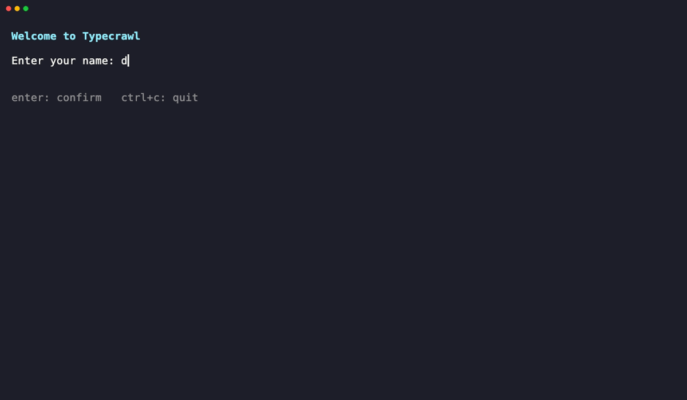

# Typecrawl

A terminal-based typing test, inspired by [monkeytype](https://monkeytype.com), with an RPG-style
progression system layered on top: XP and leveling, an HP/combo mechanic for mistakes, achievements,
daily challenges, and a "ghost" race against your own personal best.



## Install

### Homebrew (macOS/Linux)

```sh
brew install jmatelli/typecrawl/typecrawl
```

### Debian/Ubuntu (.deb)

Download the `.deb` for your architecture from the
[latest release](https://github.com/jmatelli/typecrawl/releases/latest) and install it:

```sh
sudo dpkg -i typecrawl_*_linux_amd64.deb
```

### Go install

```sh
go install github.com/jmatelli/typecrawl@latest
```

### From source

```sh
git clone https://github.com/jmatelli/typecrawl.git
cd typecrawl
go build -o typecrawl .
```

## Usage

```sh
typecrawl
```

`tc` ships alongside `typecrawl` as a shorter alias -- same binary, same flags.

On first run you'll be prompted to create a profile. From there:

- **Menu**: `tab`/`m` switch mode, `←`/`→` or `h`/`l` change duration/word count, `c`/`z`/`f` toggle
  punctuation/zen/focus-weak, `b` toggles the battle strip, `enter` starts, `p` opens your profile, `u`
  switches profile.
- **Typing**: type the words; `backspace` corrects mistakes (even across completed words); `esc` quits
  back to the menu.
- **Profile**: `a` achievements, `h` test history, `k` weak-key heatmap, `t` cycles an equipped title,
  `r` reset, `d` delete.
- **Weak keys**: `l` cycles the keyboard layout the heatmap is drawn in (QWERTY, AZERTY, QWERTZ,
  Dvorak, Colemak). The choice is saved per profile. Mistyped characters the layout has no key for,
  such as accented letters on QWERTY, are listed in an "other" row below the keyboard.

Quick-launch flags skip straight to a test:

```sh
typecrawl --profile Alice --time 30 --punctuation
typecrawl --list-profiles
typecrawl --profile Alice --export backup.json
```

### Backup and restore

`--export` writes everything a profile owns to a JSON file: level and XP, test history, personal bests
and ghost runs, settings, the daily streak and activity heatmap, weak-key counts, and daily challenge
claims. `--import` creates a new profile from that file, on the same machine or another one:

```sh
typecrawl --profile Alice --export backup.json
typecrawl --import backup.json
typecrawl --import backup.json --profile "Alice 2"   # import under a different name
```

Import never overwrites or merges into an existing profile: if the name is already taken, nothing is
imported. Files exported by v0.3.0 or earlier can still be imported, but they lack settings, weak-key
counts and daily challenge claims, and every run in them is imported as a random-words run, so progress
toward the quotes-mode achievements is not restored.

### Battle strip

Below the words, your profile's avatar fights the current word with a sword. Each correct letter cuts one
letter off the monster, and backspacing puts it back. A mistake makes the monster hit back, harder in a
combo. Special words are their own monsters and drop their reward when defeated cleanly. An active
shield is drawn in front of the avatar, and a knockout leaves it in pieces for a moment before the
results.

The strip is on by default. Press `b` in the menu to turn it off for the current profile. It also hides
itself when the terminal is smaller than 70x16, and in zen mode nothing hits back. It's only decoration:
the strip doesn't change scoring, and the pause after a knockout isn't counted in your time.

### Special words and colour

Three kinds of special word can appear in a run. Each has its own colour and a marker in front of it, so
it can be recognised without relying on the colour:

| Marker | Colour | Typed without a mistake                                                   |
| ------ | ------ | ------------------------------------------------------------------------- |
| `*`    | gold   | grants a shield that forgives the next mistake                            |
| `+`    | green  | restores HP                                                               |
| `~`    | blue   | starts a 5-second shield; appears instead of the green word in a flawless run |

The shield indicators next to the HP bar carry the same markers: `* shield active` and `~ shield 3.2s`.

Set the [`NO_COLOR`](https://no-color.org) environment variable (or `CLICOLOR=0`) to turn colour off
everywhere:

```sh
NO_COLOR=1 typecrawl
```

The typing view then uses bold for what you've typed, reverse video for mistakes, and faint text for
the words still to come. Views that use colour as a scale keep the scale another way: the activity
heatmap uses denser glyphs for busier days (`· ░ ▒ ▓ █`), the weak-key keyboard ranks keys from faint (never missed) through plain, bold, and bold underlined to
reverse video for the most-missed keys, and the ghost curve on the results graph is faint.

## License

MIT, see [LICENSE](LICENSE).
